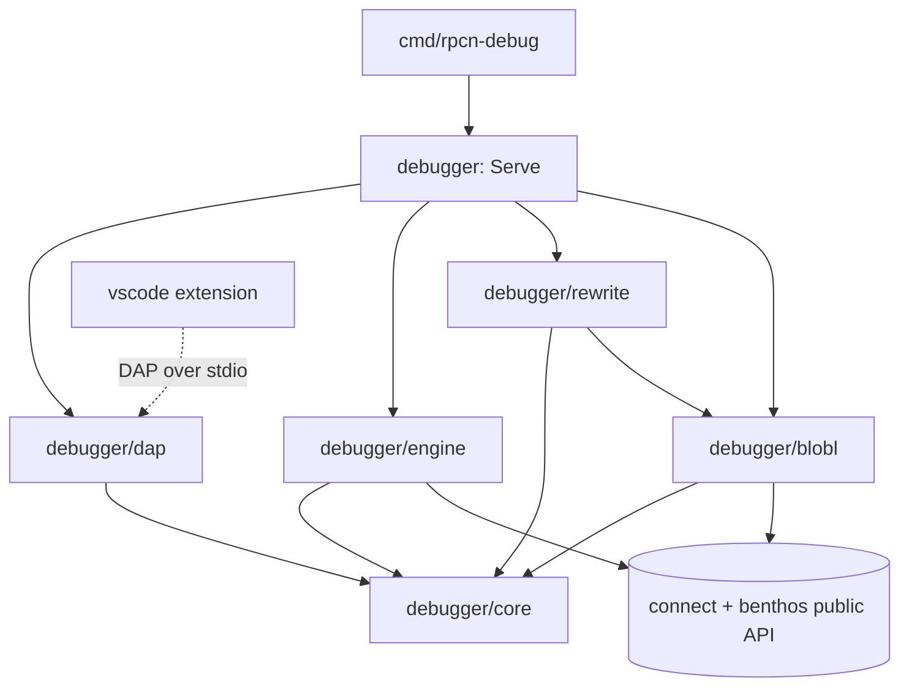
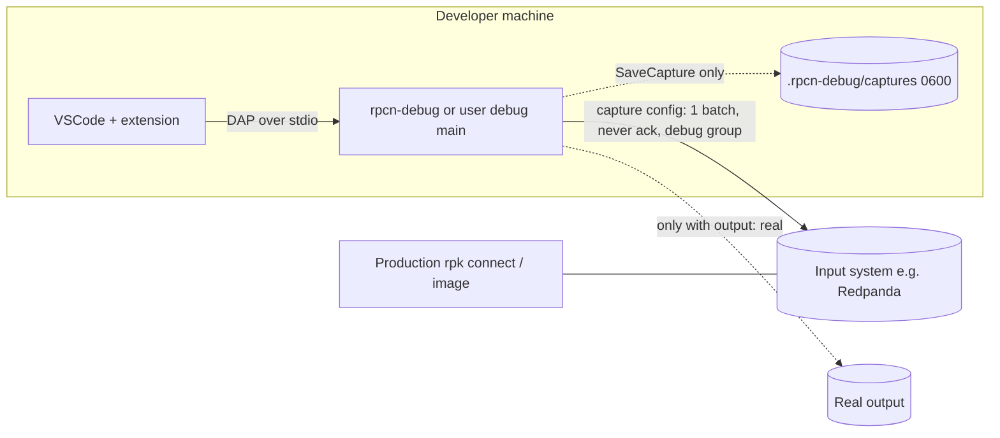
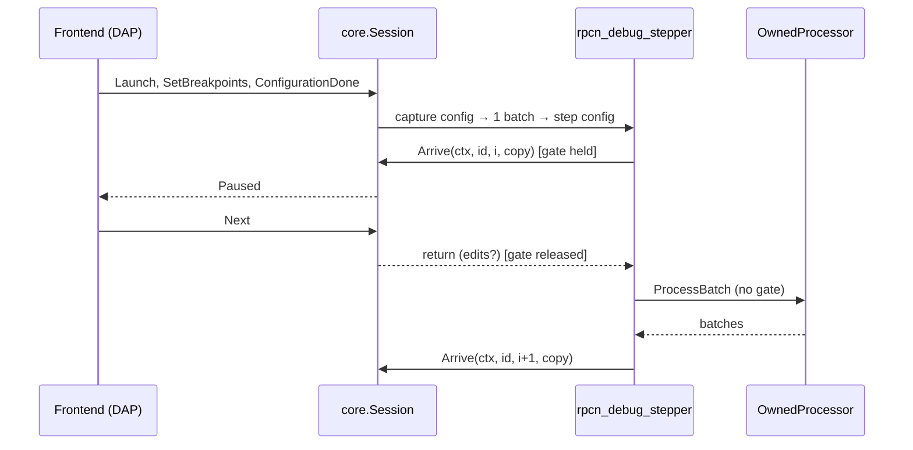

# Architecture Spine: rpcn-debugger

## Design Paradigm

**Hexagonal.** The core `Session` owns all debug state. The outside world reaches it only through ports. The Redpanda Connect engine is **linked in-process as a library**, using the public API only.

| Layer | Package | Contents |
| --- | --- | --- |
| Core (domain) | `debugger/core` | `Session`, the protocol (commands, events, errors), `Snapshot`, frames and threads, the pause gate, the `LineMap` interface |
| Engine adapters | `debugger/engine` | capture, `rpcn_debug_stepper`, `rpcn_debug_sink` |
| Config rewrite | `debugger/rewrite` | YAML → capture config + step config, the `LineMap` implementation |
| Bloblang tracer | `debugger/blobl` | statement spans, prefix replay, evaluator |
| Frontend adapters | `debugger/dap` | DAP server and `LaunchConfig` (v1) |
| Public entry | `debugger` | `Serve(env, in, out, opts...)` |
| Binary | `cmd/rpcn-debug` | thin `main` |
| Editor | `vscode/` | thin TypeScript extension |



Arrows point from dependent to dependency. `core` imports only the Go stdlib. `dap` imports only `core`.

## Invariants & Rules

Unit IDs:
- **U-CORE**: session, protocol, snapshot, frames and threads, pause gate
- **U-REWRITE**: YAML rewrite, line map
- **U-STEP**: capture, stepper, sink
- **U-BLOBL**: Bloblang tracer and evaluator
- **U-DAP**: DAP adapter
- **U-EXT**: VSCode extension
- **U-REL**: build, release, CI

### AD-1: Library first, thin binary [ADOPTED]

- **Binds:** all Go units, U-REL
- **Prevents:** logic forked between the binary and the library; a debugger that can't run the components that users compiled in; one session's plugins leaking into another.
- **Rule:**
  - All behaviour lives in the Go package `debugger`, behind one entry point: `debugger.Serve(env *service.Environment, in io.Reader, out io.Writer, opts ...Option) error`.
  - `cmd/rpcn-debug` only builds `env` from `schema.Standard(version, date).Environment()` with `components/all` imported, then calls `Serve`. Users with compiled-in plugins call `Serve` from their own `main`.
  - Each session works on `env.Clone()`. On that clone it registers `rpcn_debug_stepper`, `rpcn_debug_sink`, and the launch's RPC plugins (`public/plugin/go/rpcnloader.DiscoverAndRegisterPlugins`). The clone is discarded on terminate and on restart. The caller's `env` is never modified.
  - The exported API of `debugger` follows semver from v1.

### AD-2: Public engine API only, linked in-process [ADOPTED]

- **Binds:** all Go units
- **Prevents:** a fork that breaks on every Connect release; dependence on a pause/step API that Connect doesn't have.
- **Rule:** Go code imports only `github.com/redpanda-data/benthos/v4/public/...` and `github.com/redpanda-data/connect/v4/public/...`. Importing any `internal/` package, vendoring or patching the engine, or controlling an external `rpk connect` process is forbidden. `depguard` enforces this in CI (AD-15). An engine change may only come as an optional upstream improvement behind an existing port.

### AD-3: Session owns all debug state through a closed protocol [ADOPTED]

- **Binds:** U-CORE, U-STEP, U-BLOBL, U-DAP
- **Prevents:** debug state split between Session and DAP; units inventing commands or events the others don't know; frontend types leaking into the engine.
- **Rule:**
  - Only `core.Session` changes debug state: breakpoints, step state, threads, frames, snapshots and the captured batch.
  - The protocol is a **closed set** defined in `debugger/core/protocol.go`, and adding a member is a spine change:
    - **Commands:** `Launch, ConfigurationDone, SetBreakpoints, SetExceptionBreakpoints, Next, StepIn, StepOut, Continue, Pause, Evaluate, SetMessage, SaveCapture, Restart, Terminate`.
    - **Events:** `ThreadStarted, ThreadExited, StepStarted, StepFinished, Paused, Continued, MessagesSkipped, AttemptStarted, StatementStepped, BreakpointResolved, Delivered, Output, Terminated`.
  - Errors are `core.Error{Code, Message, UserPath?, Line?}`. `Code` is an `UPPER_SNAKE` string constant from the registry in `debugger/core/errors.go`, which also assigns each code a stable number for DAP.
  - No go-dap type appears outside `debugger/dap`.

### AD-4: Capture-then-step, with two configs from one rewrite [ADOPTED]

- **Binds:** U-REWRITE, U-STEP, U-CORE
- **Prevents:** pausing while the input is live; Kafka offsets committed by a debug session; two units editing the config.
- **Rule:** `debugger/rewrite` turns the pipeline into two configs:
  - **(a) Capture config:** only the user's input block, with `input.processors` removed and consumer groups overridden (AD-5).
  - **(b) Step config:** the steppers in order `input.processors` → `pipeline.processors` → `output.processors`, ending in `rpcn_debug_sink` (AD-21). Shared top-level sections carry over (`*_resources`, `error_handling`).

  U-STEP then:
  1. Runs (a) with `AddBatchConsumerFunc`, takes the first batch, and **never acks it**: the consumer returns an error, and the input is stopped before stepping starts.
  2. Truncates the batch to `maxMessages` (default 10).
  3. Feeds it into (b) through `AddBatchProducerFunc`.

  Further rules:
  - U-STEP never parses or edits configs.
  - Processors are built only through stepper fields (`NewProcessorListField`). `ConfigSpec.ParseYAML` is forbidden for processors, because it can't resolve `resource:` processors. The one exception is in AD-13.
  - A `replay` Source feeds a capture file (AD-11) instead of running (a).

### AD-5: Defaults that keep production safe [ADOPTED]

- **Binds:** U-REWRITE, U-STEP, U-EXT, U-DAP
- **Prevents:** a debug session stealing, deleting or rebalancing production data; writing to production outputs; sending telemetry to production systems.
- **Rule:**
  - **Input classes**, from a table in `debugger/rewrite`:

    | Class | Inputs | Behaviour |
    | --- | --- | --- |
    | replay-safe | Kafka family with a group override, `file`, `generate`, `aws_s3` | allowed |
    | side-effecting | queues and durable consumers: SQS, AMQP, NATS JetStream, `redis_list`, … | allowed only with `"allowSideEffects": true`, with a warning naming the effect |
    | rejected | `stdin`, `http_server`, sockets | rejected; replay only |
    | unknown | anything else | treated as side-effecting |

  - **Consumer groups:** every known consumer-group field is set to `rpcn-debug-<os-user>` unless `"keepConsumerGroup": true`. The table of fields lives in `debugger/rewrite` and recurses into `broker` and `sequence`.
  - **Output:** `output` is `dry-run` (the default; results go to VSCode only), `real`, or `none`. `real` is required to write to the user's output, and it logs a warning.
  - **Dropped sections:** the rewrite drops `metrics`, `tracer`, `http` and `logger`. The engine gets a no-op metrics and tracer and the AD-15 logger.
  - The captured batch is never acked, whatever the options.

### AD-6: The config rewrite is owned by one unit and never touches disk [ADOPTED]

- **Binds:** U-REWRITE, U-STEP, U-BLOBL, U-DAP
- **Prevents:** several places parsing the YAML differently; line numbers that disagree with engine errors; logs showing rewritten paths; user files being modified.
- **Rule:** Only `debugger/rewrite` parses or rewrites pipeline YAML. It uses `gopkg.in/yaml.v3`, the same library the engine uses, and never writes the user's file. `${VAR}` interpolations are kept verbatim; the engine resolves them (AD-22).
  - **What it wraps:** the child processor lists of `input`, `pipeline`, `output`, `branch`, `switch` cases, `try`, `catch`, `for_each`, `while`, `workflow.branches.*`, `parallel`, `group_by` groups and `retry`, and the same lists inside `processor_resources`.
  - **Unknown parents:** a parent not in this list (a third-party plugin, or a composite output's per-case processors) stays unwrapped. It runs as one opaque step, with a warning.
  - **Strict mode:** if `error_handling.strict` is true, every stepper is written with `strict: true` (AD-7).
  - **LineMap and Translate:** `LineMap` and `Translate(enginePath) userPath` are interfaces in `debugger/core`, implemented by `debugger/rewrite`. The single slog handler that `Serve` builds translates every engine path and every Bloblang error line before anything reaches a frontend or stderr.
  - **Mapping base line:** for a literal (`|`) block, the base line is `Node.Line + 1`. For a plain scalar on the key's line, it is `Node.Line`. Statement line = base + the 0-based line inside the value. Folded (`>`) and quoted mapping values aren't statement-stepped; they run as one step, with a warning. U-REWRITE computes file lines, and U-BLOBL receives `(source, baseLine)`.

### AD-7: Each stepper mode copies its parent's engine behaviour [ADOPTED]

- **Binds:** U-STEP, U-REWRITE
- **Prevents:** debugger output that differs from the real run. Example: the `try` remainder running on a message that already failed.
- **Rule:** There are exactly two modes. `all` mirrors `ExecuteAll`, and when the stepper has `strict: true` it skips batches whose first message has an error, as the engine does in strict mode. `try` mirrors `ExecuteTryAll`. The mode comes from this table. Adding a parent requires a new row plus an equivalence case (AD-8).

| Parent | Engine function | Mode | Stepper entered |
| --- | --- | --- | --- |
| `input`/`pipeline`/`output`, `branch`, `switch` case, `while`, `workflow` branch, `group_by` group | `ExecuteAll` | `all` | once per batch / loop / group |
| `for_each`, `parallel`, `retry` | `ExecuteAll` per message | `all` | once per message (and per attempt for `retry`) |
| `catch` | `ExecuteCatchAll`; the parent picks the failed messages and clears errors afterwards | `all` | once per caught message |
| `try` | `ExecuteTryAll` | `try` | once per message |

Steppers accept and return several batches, because `group_by` splits and reorders them.

### AD-8: The debugger must not change the output [ADOPTED]

- **Binds:** U-STEP, U-REWRITE, U-REL
- **Prevents:** silent changes in behaviour as processors or Connect versions are added.
- **Rule:**
  - For every case in `testdata/equivalence/`, the batches received by `rpcn_debug_sink` must equal those from the same pipeline run without the rewrite. "Equal" covers content, metadata, errors, batch boundaries and order. Each case runs twice: once with no pauses, and once with a scripted Step Over at every stop.
  - The corpus covers every row of AD-7, plus strict mode.
  - The never-ack integration test (a Redpanda container, which must show no committed offsets for the debug group) and the capture round-trip test (AD-11) run in the same CI job.
  - Equivalence is guaranteed only when nothing time-budgeted is paused. When a stop happens inside a parent with a time budget (`retry` backoff or `max_elapsed_time`, `branch`/`workflow` timeouts, rate limits), the debugger emits a warning `Output` event.

### AD-9: How a stop is decided [ADOPTED]

- **Binds:** U-STEP, U-CORE, U-DAP
- **Prevents:** stop-event storms; data races on step state; nested-stepper deadlocks; steps on one thread stopping another.
- **Rule:**
  - At each stop position, a stepper calls `Session.Arrive(ctx, stepperId, childIndex, batchCopy)`. `Arrive` takes the process-wide pause gate and evaluates the stop predicate **while holding it** (breakpoints, conditions, the step state of this thread, a pending `Pause`).
  - If the predicate is false, `Arrive` returns at once and emits no event. If it's true, it emits `Paused`, blocks until a resume, and returns any `SetMessage` edits (AD-19).
  - The gate is never held while a processor runs.
  - Step state is stored per thread. `Next`/`StepIn`/`StepOut` stop only the thread they were issued on. Other threads stop only on breakpoints or exceptions.
  - Every resume is process-wide (`allThreadsContinued: true`), and a stop is reported with `allThreadsStopped: false`. `Pause` makes the next `Arrive` on any thread stop. Single-thread execution requests aren't supported.
  - Step order across concurrent threads is non-deterministic, while results stay deterministic (AD-8).

### AD-10: What a step is [ADOPTED]

- **Binds:** U-CORE, U-DAP, U-BLOBL, U-STEP
- **Prevents:** frontends or units inventing different stepping behaviour or repeat counts.
- **Rule:**
  - **Stop positions:** before child processor `i` of a stepper entry (`childIndex = i`), plus after its last child (`childIndex = n`, reported at the line of the parent's key).
  - **Step Over** goes to the next stop of the same entry, or the parent's next stop.
  - **Step In** enters the child stepper. On a `mapping`/`mutation`/`bloblang` processor or a `branch` `request_map`/`result_map`, it enters the Bloblang statements (AD-13).
  - **Step Out** runs to the end of the **current entry** (one message, attempt, loop or group), not of all entries.
  - A **frame** is one stepper entry. Its `repeatLabel` (`[msg i/n]`, `[attempt i/max]`, `[loop i]`, `[group i]`) is computed by the stepper from the per-entry counter in its parent frame (AD-17) and sent in `StepStarted`/`AttemptStarted`. The Session displays it and never computes it.
  - **Exception breakpoints:** `on-error` stops at the first stop after a processor sets a new error on any message.

### AD-11: One lossless, versioned Snapshot [ADOPTED]

- **Binds:** U-CORE, U-DAP, U-BLOBL, U-STEP
- **Prevents:** DAP Variables, replay files and tests each using a different message model; replay producing different output from the capture.
- **Rule:** `core.Snapshot` is the only representation of message state:
  `{schemaVersion, position{threadId, frameId, stepperId, childIndex, userPath, file, line}, batches[{messages[{index, content{raw(base64), text?, json?}, metadata[{key, type, value, text?, internal}], error?}]}], skipped[{index, reason}], bloblang?{root|unassigned, vars, meta, recomputed[]}}`.
  - **Metadata `type`** is one of the closed set `string | bytes | int | float | bool | timestamp | object | array | null`.
  - **`value` is lossless:** bytes are base64, ints are decimal strings, timestamps are RFC 3339 with nanoseconds. `text` is for display only.
  - Keys starting with `__` have `internal: true`. U-DAP puts them in a collapsed "internal" scope, and the core never filters them.
  - The Session keeps **one Snapshot per live frame**.
  - **Capture files:** only the capture Source writes them, and only on `SaveCapture`. A file holds the truncated batch plus `skipped` (reason `maxMessages`). Messages skipped by `try` are reported by `MessagesSkipped`, never in the file.
  - Readers reject a newer major `schemaVersion`. A round-trip test (capture → file → replay → Snapshot) must be byte-identical.

### AD-12: Thin extension; Go owns the launch contract [ADOPTED]

- **Binds:** U-EXT, U-DAP
- **Prevents:** pipeline logic duplicated in TypeScript; schema, defaults or enums drifting between TypeScript and Go.
- **Rule:**
  - The extension only:
    1. registers the debug type `redpanda-connect`
    2. contributes the generated `launch.json` schema
    3. gets the binary (AD-23)
    4. starts it over stdio (`DebugAdapterExecutable`)
    5. warns on a version mismatch (AD-14)
  - The Go struct `dap.LaunchConfig` is the only source of the schema, the defaults (struct tags) and the enum values. The schema in `package.json` is generated from it and checked in CI.
  - The extension adds nothing to the launch config except a missing `pipeline` (set to the active editor file) and `cwd` (set to the workspace folder).
  - Relative paths resolve against `cwd`. Enum values are lowercase kebab-case. An unknown key or value is a `LAUNCH_INVALID` error, never ignored.
  - A future webview may only render Snapshots it gets through custom DAP requests.

### AD-13: Bloblang runs in Go; statement stepping is a view [ADOPTED]

- **Binds:** U-BLOBL, U-REWRITE, U-CORE, U-DAP
- **Prevents:** Watch or condition results that differ from the pipeline; two implementations of the statement-boundary algorithm; the debugger reporting a mapping result the engine didn't produce.
- **Rule:**
  - **Evaluation.** Every evaluation (Watch, `evaluate`, breakpoint conditions, `check` results, interpolation values):
    - runs in Go, against the paused thread's **copy** of the batch;
    - runs while the gate is held;
    - has batch context, through `MessageBatch.BloblangExecutor(exec).Query(i)`;
    - is parsed with the **pipeline's Bloblang environment**. That environment is reached by parsing the expression as a `NewBloblangField` through `ConfigSpec.ParseYAML(…, env)`, the only allowed use of `ParseYAML`.

    Every evaluation executor is newly parsed and never shared with pipeline processors. `BloblangQueryValue` is forbidden.
  - **Statement stepping** goes through the `BloblangTracer` port. U-BLOBL is the only owner of `Statements(source, baseLine) []StatementSpan`, and U-REWRITE calls it to put statement lines into `LineMap`. A boundary is where the prefix parses and the next line isn't indented.
    - v1 uses prefix replay: the state after statement k = running statements 1..k. `mutation` starts `root` from the input; `mapping` shows `root` as `unassigned` until its first assignment. Variables are read by appending `root = $name`.
    - Tracing runs lazily, only for the focused message and only on Step In or a statement breakpoint. Above 200 statements, tracing is disabled and the user is told.
  - **Recomputed values.** Values from `uuid_v4`, `uuid_v7`, `ulid`, `ksuid`, `nanoid`, `snowflake_id`, `now`, `timestamp_unix*`, `random_int`, `fake`, `counter`, `count` and `with_schema_registry_header` are labelled `recomputed`. Values from `env`, `file`, `file_rel` and `hostname` are labelled environment-dependent.
  - **Authority.** The trace is a view. The real processor's output is authoritative, and any difference is flagged.
  - A separate Bloblang interpreter is forbidden. A future upstream statement hook may replace prefix replay behind the same port.

### AD-14: Each release pins one Connect version and one launch schema [ADOPTED]

- **Binds:** U-REL, U-EXT, U-DAP
- **Prevents:** confusing "unknown field" errors when the user's Connect is newer; the extension and the binary disagreeing on the launch contract.
- **Rule:**
  - Each `rpcn-debug` release pins exactly one `connect/v4` (with its `benthos/v4`).
  - The binary reports `rpcnDebugVersion`, `rpcnConnectVersion` and `launchSchemaVersion` in the DAP `initialize` response.
  - The extension refuses a major mismatch of `launchSchemaVersion`. It warns when `rpk connect --version` differs by a minor or major version from `rpcnConnectVersion`.
  - A Connect bump requires the AD-8 job to pass.

### AD-15: stdout belongs to DAP [ADOPTED]

- **Binds:** U-DAP, U-STEP, U-CORE, U-REWRITE, U-REL
- **Prevents:** engine logs, stray prints or pipeline I/O corrupting the DAP stream.
- **Rule:**
  - When `Serve` runs over stdio, only the DAP encoder writes to `out`.
  - All logs go through one `log/slog` handler, which sends them to stderr and to DAP `Output` events (after AD-6 translation).
  - In stdio mode the rewrite rejects `stdin` inputs and redirects `stdout`/`stderr` outputs to the dry-run sink, with a warning, even under `output: real`.
  - `golangci-lint` enforces this together with AD-2: `forbidigo` bans `fmt.Print*` and `os.Stdout` in `debugger/...`, and `depguard` bans `internal/` imports.

### AD-16: Stepper identity comes from the rewrite [ADOPTED]

- **Binds:** U-REWRITE, U-STEP, U-CORE
- **Prevents:** LineMap keys that don't match what a stepper knows at runtime; frames that can't be told apart when one stepper config is entered many times.
- **Rule:**
  - The rewrite gives every stepper a dense integer `id`, unique within one rewrite, and writes it into the stepper config with `parent`, `mode`, `strict`, `concurrent` and `lines`.
  - `concurrent` is true when the parent runs entries on several goroutines: `workflow` branches, `parallel`, and `retry` with `parallel: true`.
  - `LineMap` is keyed by `(stepperId, childIndex)`.
  - A stepper never derives its identity from engine paths, labels or logger fields.
  - A `processor_resources` stepper has one `id`. Its call site comes from the frame stack (AD-17).

### AD-17: Frames and threads travel in ctx [ADOPTED]

- **Binds:** U-STEP, U-CORE, U-DAP
- **Prevents:** goroutine-ID hacks; concurrent siblings collapsing into one thread; thread IDs changing on every step.
- **Rule:**
  - The frame stack is an immutable list stored in `context.Context` under a key owned by `debugger/core`. Each stepper entry pushes one frame `{frameId, stepperId, repeatLabel, callSite}` and passes the new ctx to its children.
  - A stepper calls `Session.ForkThread` when its config has `concurrent: true` or when ctx has no frame. Otherwise it inherits the parent frame's thread.
  - The entry that forked a thread calls `Session.ExitThread` when it returns. The Session emits `ThreadStarted`/`ThreadExited`.
  - Using goroutine IDs is forbidden.
  - A stepper with a non-root `parent` that finds no frame in ctx logs `CTX_LOST`. The AD-8 corpus has one case per AD-7 parent that proves ctx reaches the child.
  - `threadId` is stable for the life of its thread. Only `frameId` and `variablesReference` become invalid on resume.

### AD-18: Breakpoints are Session state [ADOPTED]

- **Binds:** U-CORE, U-DAP, U-REWRITE, U-BLOBL
- **Prevents:** two owners of breakpoints; breakpoints that are verified but never hit; units choosing different condition semantics.
- **Rule:**
  - Breakpoints arrive as `SetBreakpoints{file, lines[], conditions[]}`. Those received before the rewrite stay pending and are resolved at the end of `Launch`. Stepping starts only after `ConfigurationDone`.
  - **Resolution:**
    - A line inside processor P's YAML span binds to "before P", and is reported verified at P's first line.
    - A line inside a statement-steppable mapping binds to the statement whose span contains it.
    - Any other line is unverified. Each result is sent as `BreakpointResolved`.
  - **Hitting:**
    - A statement breakpoint makes `Continue` enter statement stepping of that processor.
    - A breakpoint inside a `processor_resources` entry hits at every call site.
    - A condition is evaluated for each message (AD-13). It stops if **any** message matches, and the Snapshot focuses the first matching one.
  - Logpoints and hit counts aren't supported in v1.

### AD-19: The stepper owns the batch it is processing [ADOPTED]

- **Binds:** U-STEP, U-CORE, U-BLOBL
- **Prevents:** snapshots showing values that never existed; `SetMessage` racing a processor; two units modifying one message.
- **Rule:**
  - A stepper owns its batch for its whole entry. At each `Arrive` it passes a **deep copy** (content bytes, metadata and errors), and the Session builds the immutable Snapshot from that copy. A Snapshot never references engine objects.
  - `SetMessage{frameId, batch, index, content?, metadata?}` is valid only for the top frame of the stopped thread. The Session validates it and returns it from `Arrive`. The **stepper** applies it to its own batch before releasing the gate.
  - No other unit modifies a `*service.Message`.

### AD-20: Restart re-steps the same batch [ADOPTED]

- **Binds:** U-CORE, U-DAP, U-EXT, U-STEP
- **Prevents:** the Restart button producing a different batch depending on which code path handles it.
- **Rule:**
  - `Restart` re-reads and re-rewrites the pipeline YAML (a new LineMap, with breakpoints resolved again), discards all threads and frames and the cloned env, and re-steps the **already captured batch** through an in-memory replay Source.
  - It never re-captures. A fresh capture is a new launch.
  - U-DAP advertises `supportsRestartRequest: true`.
  - If the rewrite fails, the session stays alive and reports a `core.Error` with `UserPath`/`Line`.

### AD-21: Delivery happens at `rpcn_debug_sink` [ADOPTED]

- **Binds:** U-STEP, U-REWRITE, U-CORE, U-REL
- **Prevents:** dry-run silently dropping `output.processors`; the boundaries the sink compares drifting between dry-run and real; delivered results that have no shape.
- **Rule:**
  - The step config's output is always `rpcn_debug_sink`. It receives batches **after** `output.processors` and emits `Delivered{Snapshot}`.
  - In `dry-run` it records the batches exactly as received (`MaxInFlight = 1`). It doesn't apply output-level `batching`, and warns that production boundaries may differ.
  - In `real` it also forwards each batch to the user's output, built from the original block. In `none` it discards them.
  - AD-8 compares what the sink received.

### AD-22: Secrets and captured data [ADOPTED]

- **Binds:** U-DAP, U-EXT, U-STEP, U-CORE, U-REWRITE
- **Prevents:** credentials in committed `launch.json`; production data left in the workspace; env vars resolved differently by different units.
- **Rule:**
  - **Credentials in `launch.json`:** `env` values accept `${env:NAME}` references, and `envFile` names a file. `license` accepts only a file path or an env reference, never a literal. The schema says so.
  - **Env resolution:** the engine resolves `${VAR}` in the pipeline through one lookup that the Session builds, in this order: process env, then `envFile`, then `env`. It is set with `StreamBuilder.SetEnvVarLookupFunc`.
  - **License:** read from `license`, then `REDPANDA_LICENSE`, then `REDPANDA_LICENSE_FILEPATH`. It is applied through `public/license.StoreCustomLicenseBytes`.
  - **Capture files:** written only on `SaveCapture`, with mode `0600`. The first save creates `.rpcn-debug/.gitignore` containing `*`.
  - **Credentials for the input system:** only from the pipeline config. The debugger adds none.
  - **Evaluate** is unrestricted (it's a local development tool), and the docs say so.
  - **Telemetry:** none is collected by the binary or the extension.

### AD-23: How the extension gets the binary [ADOPTED]

- **Binds:** U-EXT, U-REL
- **Prevents:** the extension and the release pipeline disagreeing on artifact names or versions; running an unverified downloaded binary.
- **Rule:**
  - Binary resolution order: the `rpcnDebug.binaryPath` setting, then a bundled binary, then a download.
  - **MVP (local distribution):** only the first two apply: the setting, then the binary bundled in a locally built `.vsix`. The download step arrives with the Marketplace release.
  - Extension `X.Y.*` downloads binary `X.Y.*` from `<releases>/vX.Y.Z/rpcn-debug_<os>_<arch>[.exe]`.
  - Before running a downloaded binary, the extension checks its SHA-256 against the release's signed `checksums.txt`. If the check fails, it doesn't run it.

## Consistency Conventions

| Concern | Convention |
| --- | --- |
| Names | DAP type `redpanda-connect`; plugins `rpcn_debug_stepper` and `rpcn_debug_sink` (must match `^[a-z0-9]+(_[a-z0-9]+)*$`); binary `rpcn-debug` |
| User paths | `pipeline.processors[2].branch[1].switch.case[0]`, `workflow.branches.a`, `group_by.group[1]`, `processor_resources.<label>`, with indices 0-based |
| Lines | 1-based everywhere (yaml.v3, and DAP `linesStartAt1: true`) |
| DAP handles | `threadId` stable per thread; `frameId` and `variablesReference` become invalid on every resume (AD-17) |
| Errors | Processor errors on messages are data (`Snapshot.error`). Session failures are `core.Error` (AD-3) |
| Logging | `log/slog`, one handler, stderr plus DAP `Output` (AD-15) |
| Launch keys | camelCase: `pipeline`, `cwd`, `resources[]`, `maxMessages`, `output` (`dry-run`, `real` or `none`), `keepConsumerGroup`, `allowSideEffects`, `rpcPlugins[]`, `replay`, `env`, `envFile`, `license` |
| Equivalence tests | `testdata/equivalence/<name>/{pipeline.yaml, input.snapshot.json, expected.snapshot.json}`, with inputs and outputs in the AD-11 shape |
| CI lint | `golangci-lint` with `forbidigo` and `depguard` (AD-2, AD-15); a launch-schema check (AD-12) |

## Stack

| Name | Version |
| --- | --- |
| Go | 1.26.x (`go 1.26.6`, matching Connect v4.112.0) |
| github.com/redpanda-data/connect/v4 | v4.112.0 |
| github.com/redpanda-data/benthos/v4 | v4.81.0 |
| github.com/google/go-dap | v0.12.1-0.20260926015354-7505f696918e |
| gopkg.in/yaml.v3 | v3.0.1 (archived upstream; kept because benthos uses it directly) |
| TypeScript | 6.0.3 |
| VS Code minimum (`engines.vscode`) / @types/vscode | ^1.120.0 / 1.120.0 |
| @vscode/vsce | 4.0.0 |
| @vscode/debugadapter-testsupport | 1.68.0 |

## Structural Seed

```text
rpcn-debugger/
  go.mod                      # module github.com/ajurcenk/rpcn-debugger
  debugger/                   # public entry: Serve, Option
    core/                     # Session, protocol.go, errors.go, Snapshot, frames, gate, LineMap iface
    engine/                   # capture, rpcn_debug_stepper, rpcn_debug_sink
    rewrite/                  # capture + step configs, LineMap, input-class and group-field tables
    blobl/                    # Statements, prefix replay, evaluator
    dap/                      # DAP server, LaunchConfig (schema source)
  cmd/rpcn-debug/             # thin main (AD-1)
  testdata/equivalence/       # AD-8 corpus
  vscode/                     # TypeScript extension (AD-12, AD-23)
```



Environments: the debugger runs only on a developer machine, next to the editor, with network access to the input system. Production deployments are never changed. CI: an equivalence and integration job (AD-8), lint (AD-15), schema check (AD-12), and release builds per OS/arch (AD-23).



## Unit → Architecture Map

| Unit | Lives in | Governed by |
| --- | --- | --- |
| U-CORE | `debugger/core` | AD-3, AD-9, AD-10, AD-11, AD-17, AD-18, AD-19, AD-20 |
| U-REWRITE | `debugger/rewrite` | AD-4, AD-5, AD-6, AD-7, AD-16 |
| U-STEP | `debugger/engine` | AD-2, AD-4, AD-7, AD-8, AD-9, AD-19, AD-21 |
| U-BLOBL | `debugger/blobl` | AD-13 |
| U-DAP | `debugger/dap` | AD-3, AD-12, AD-15, AD-18 |
| U-EXT | `vscode/` | AD-5, AD-12, AD-14, AD-22, AD-23 |
| U-REL | `cmd/`, CI | AD-1, AD-8, AD-14, AD-15, AD-23 |

## Deferred

| Item | Why it can wait |
| --- | --- |
| DAP over TCP; running the debugger in a container or Kubernetes pod | The v1 environment is a developer laptop. The `Frontend` port doesn't change |
| MCP and TUI frontends | The port exists (AD-3) |
| Upstream Bloblang statement hook; upstream `rpk connect debug` | Each sits behind an existing port or `Serve` (AD-1, AD-13) |
| Webview (pipeline graph, message diff) | Bound by AD-12 (render Snapshots only) |
| Logpoints and hit-count breakpoints | Excluded from v1 by AD-18 |
| Release hosting, signing tool, Marketplace / Open VSX publication, binary download | Post-MVP. The MVP is a local `.vsix` (personal project). The contract is fixed by AD-23 |

## Open Questions

| Question | Blocks | Revisit when |
| --- | --- | --- |
| License timing: `processor_resources` are built during `Build()`, possibly before `StoreCustomLicenseBytes` can run | U-REL, enterprise components | First U-REL spike with `components/all` |
| Stable message identity across `group_by` reordering, for diffs and tests, without adding metadata that changes the output | U-CORE diffs, webview | Before the message-diff feature |
| Binary size and CGO needs of `components/all` across OS/arch | U-REL | First release build |
| Upstream goal (the user mix is confirmed: mostly stock `rpk connect` on laptops) | AD-1 emphasis | If upstream `rpk connect debug` becomes the main channel |
| Hexagonal ports were taken without stated roadmap priorities | AD-3 port surface | If no second frontend or replay use appears within 3 releases |
